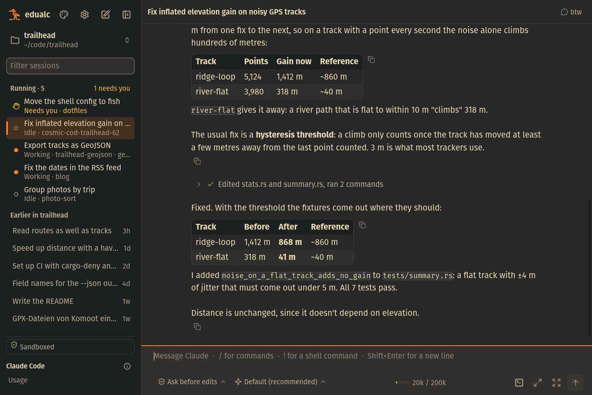
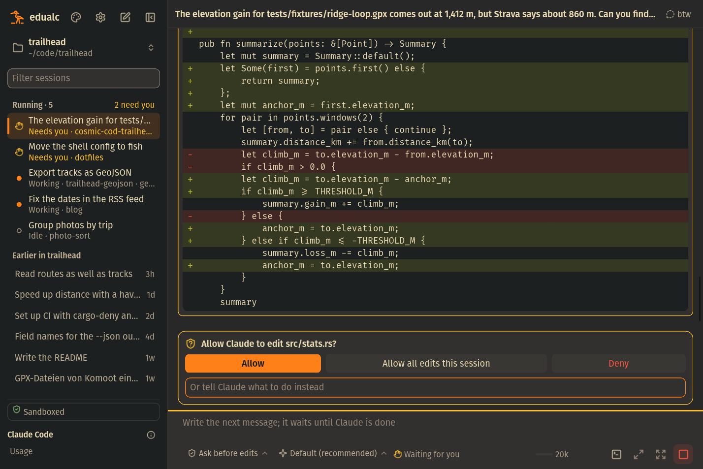
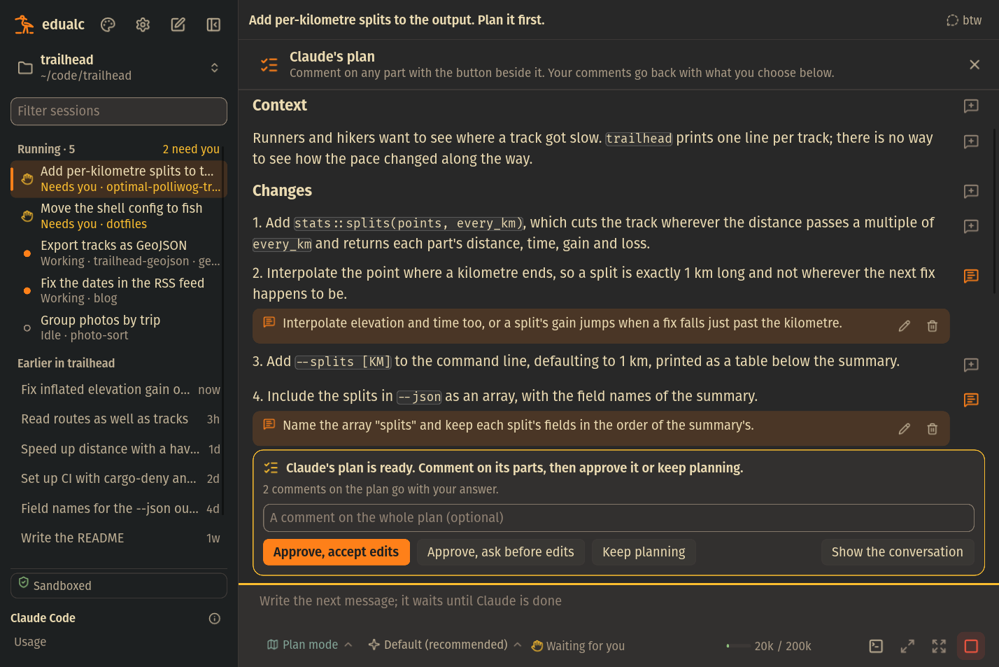
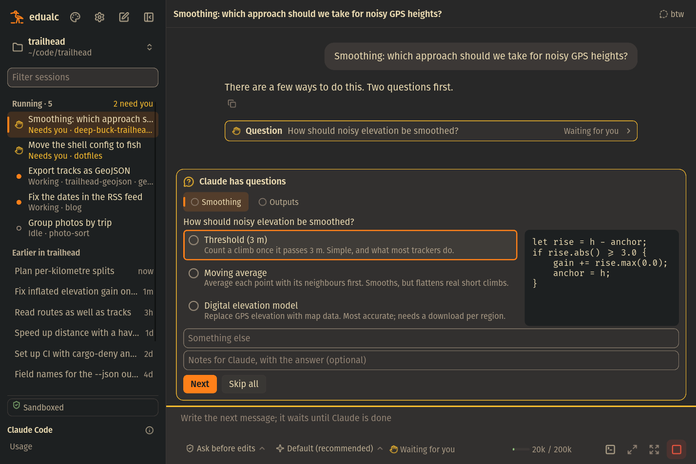
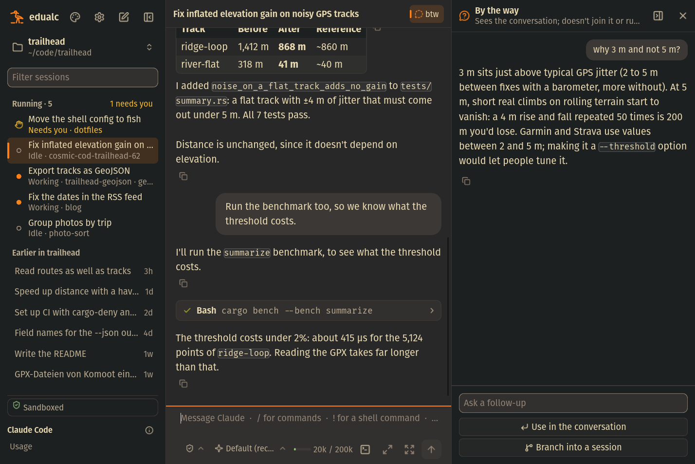
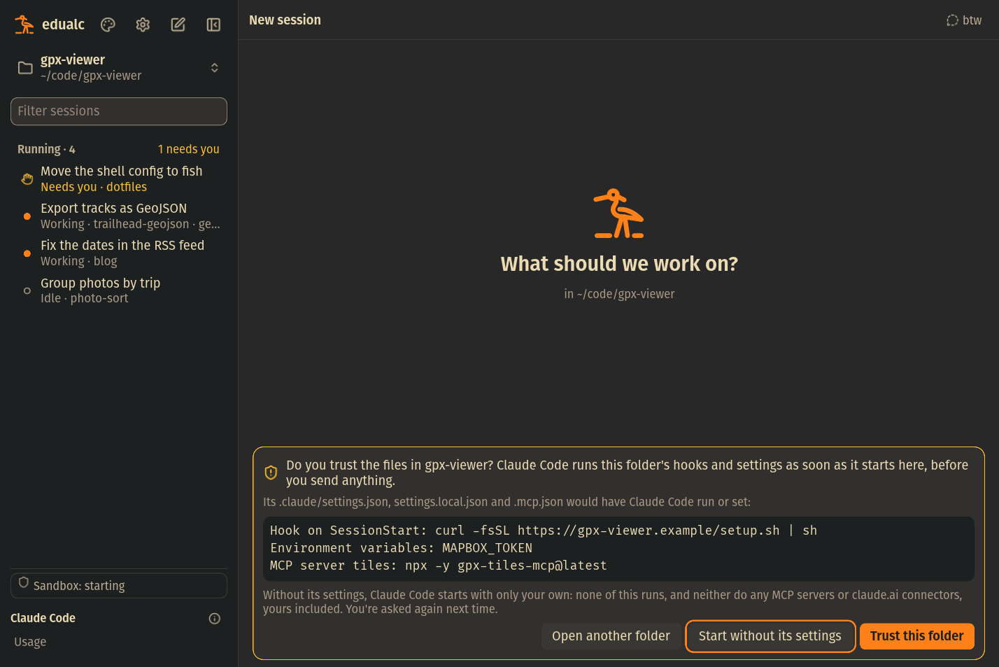
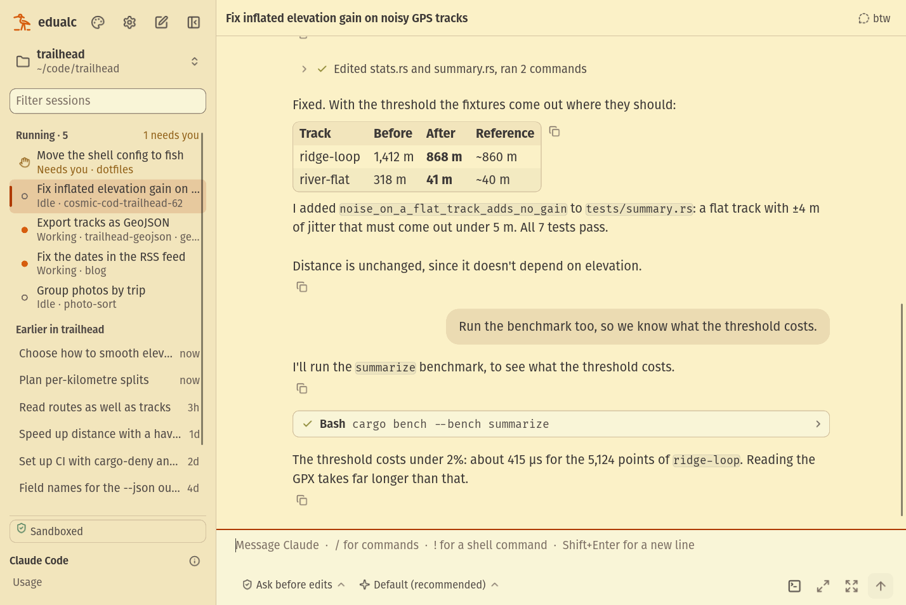

# edualc


**A native Linux desktop window for Claude Code, with a sandbox around it.**

edualc runs the `claude` CLI you already have, so your sign-in, settings, CLAUDE.md, skills, hooks,
MCP servers and sessions work as they do in the terminal, and a session moves freely between the
two. What it adds is a window made for reading and steering the work, and a sandbox that keeps
Claude Code to your project.



**Also in a browser.** `edualcd`, edualc's daemon, is a Dioxus fullstack server too: it serves
the same window as a page, drawn from the same code, for when you'd rather have it in a tab
(see [Use](#use)). `edualcd --demo` serves it on a demo project with Claude played by a script,
for trying it out: nothing runs there.

**And on Android.** The same window again, as an app that pairs with an edualcd as the native
window does (see [Use](#use)).

## What it does differently

- **Sandboxed.** Claude Code and everything it starts (commands, hooks, MCP servers) run under
  Landlock: the system is read-only, only the project, caches and a Claude Code home of the
  session's own are writable, and keys, keyrings, browser profiles and other private files are out
  of reach. No `sudo`, and no D-Bus. A folder you
  haven't trusted yet shows what its settings would run before anything runs.
- **A conversation you can read.** Markdown is rendered, and everything can be selected and copied.
  Tool calls are cards with diffs, and a run of them folds into one line.
- **Permissions you can't misclick.** Allow, deny with what to do instead, or always allow with the
  exact rule named. The buttons arm a moment after a request appears, and each answer is bound to
  the request it was given for.
- **Plans you review like a document.** Comment on any heading, paragraph or list item, then send
  Claude back to planning or approve with your notes attached.
- **Every session on the machine in one list.** Sessions running in any terminal or folder, with
  what each is doing, and a notification when one needs you. A session keeps running when its
  window closes, and keeps a name other sessions can message it by.
- **Side questions on the side.** `/btw` answers in a panel next to the conversation, which goes on
  without it.
- **A native app.** Rust and Slint, no browser engine, and no polling while nothing happens. Every
  control is reachable by keyboard, screen readers can read the window, and it follows the
  desktop's light or dark setting and text size.

All of it in detail: [docs/features.md](docs/features.md).

## Screenshots

| | |
|---|---|
|  |  |
|  |  |
|  |  |

## Install

You need Linux on Wayland, a kernel with Landlock (5.13 or later), and Claude Code installed and
signed in (`claude` on the PATH).

The [releases](https://github.com/felintusun/edualc/releases) have packages for x86_64 and aarch64:

- **Debian 12+, Ubuntu 24.04+:** `sudo apt install ./edualc_*.deb`
- **Fedora, AlmaLinux 10:** `sudo dnf install ./edualc-*.rpm`
- **Arch:** `makepkg -si` in [`dist/aur/edualc`](dist/aur/edualc)
- **Anything else:** the tarball has the binaries, the page, edualcd's user service, the desktop
  entry and the icon.

`xdg-dbus-proxy` (for screen readers and the light or dark setting) and `wl-clipboard` (for pasting
images) are recommended.

## Use

edualc's window runs Claude Code through `edualcd`, a user service, on this machine or another.
Once, start it and pair the window with it:

```sh
systemctl --user enable --now edualcd
edualc --pair "$(edualcd --pair)"
```

Then:

```sh
edualc [DIR] [PROMPT]
edualc --resume SESSION
```

`edualc --help` lists the rest. The folder is one on edualcd's machine; with none given, it is
where edualc was started if that is a folder there too, else the home folder there.

**On another machine.** Run edualcd there, listening on its network (`edualcd --listen
0.0.0.0:7878`, or the service's override, see `assets/edualcd.service`), and pair with the address
`edualcd --pair --listen 0.0.0.0:7878` prints there: `edualc --pair 'https://…' --as box`, then
`edualc --server box`. The line is TLS, with a certificate edualcd made itself that the window
pins; the address holds the token, which lets whoever has it run Claude Code as you on that
machine: keep it as you keep an SSH key. Links, notifications and pasted images are the window's
own desktop's; Claude Code, its files and the sandbox are edualcd's machine's.

**In a browser.** The address `edualcd --pair` prints is the page's too (add `&dir=/path` for
another folder than the home). The browser doesn't know edualcd's certificate and asks first:
check that its SHA-256 is the address's `fingerprint`. The page and the windows share edualcd,
its sessions and the settings. `edualcd --demo` serves the demo instead, over plain HTTP, which
needs no token.

**On Android.** The app lists the edualcds it is paired with, and pairs with another by the
address `edualcd --pair` prints there (on edualcd's network: `--listen` and `--name` as above);
it reaches the one it reached last as it starts. A demo's address (`http://host:port/`) works
too, and the window says its line isn't encrypted. The app opens the session it showed last
there again, and the settings' "Choose another edualcd" goes back to the list. Its pairings are
kept out of Android's backups. Links open in Android's browser, notifications are Android's (it
asks you as the window first opens), and the composer's image button pastes the clipboard's
image. Enter starts a new line on the screen's keyboard (the send button sends), and sends from
a keyboard with keys.

Settings live in `~/.config/edualc/settings.json` on edualcd's machine; to let the sandbox read
or write more folders, add them in the settings, or to `sandbox_read` or `sandbox_write` there.
edualcd keeps its certificate and token in `~/.local/state/edualcd`; remove that folder to make
them anew (every window then pairs again).

## Known limits

- A sandboxed session gets your sign-in once, as it starts, and Claude Code doesn't renew it from
  there. When it runs out (within 8 hours), the conversation says so, the session starts again
  with your current sign-in, and you send that message again.
- `@` file mentions aren't there yet, and images are pasted, not dropped in.
- In the page, paths aren't shortened to `~`.
- A window and its edualcd must be the same version. Restarting edualcd (to update it) ends the
  sessions it runs; their conversations are kept, to be continued.
- A window whose line is lost reaches edualcd again by itself and opens its session again; what
  was typed while the line was down isn't sent.
- Slint comes from a fork at an unreleased commit, until the features edualc needs are released.
- The Android app keeps its line only while it is shown: Android stops an app in the background,
  and the app reaches edualcd again as it comes back; a session that waits for you meanwhile is
  told only once the app runs again. Its images are drawn on the window's thread, which a
  conversation of many large ones slows. Its name on the launcher is "Edualcd" (dx
  names it after the binary), and there is no release of it yet: build it as below.

## Building

`cargo build --release` builds the window. edualcd and its page are built by Dioxus's CLI:
`dx bundle -p edualc-server --platform web --fullstack --release`, whose `server` and `public/`
go beside the window as `edualcd` and `public/` (`cargo edualcd` builds the daemon alone, without
the page). How the code is laid out, and how a
release is made, is in [docs/architecture.md](docs/architecture.md).

The Android app is built by dx too, with the Android SDK and NDK (`ANDROID_HOME`,
`ANDROID_NDK_HOME`, a JDK 17 or later as `JAVA_HOME`) and the Rust target:
`dx build --android -p edualc-server --features mobile --target aarch64-linux-android` (for the
emulator, `x86_64-linux-android`); `dx serve` with the same arguments installs and starts it on
a running emulator or a connected phone. In the emulator, the machine it runs on is `10.0.2.2`:
`edualcd --demo` there is `http://10.0.2.2:7878/`.

## License

GPL-3.0-or-later ([LICENSE](LICENSE)). Slint is used under its GPL-3.0-only option, so a built
edualc is distributed under GPL-3.0.
